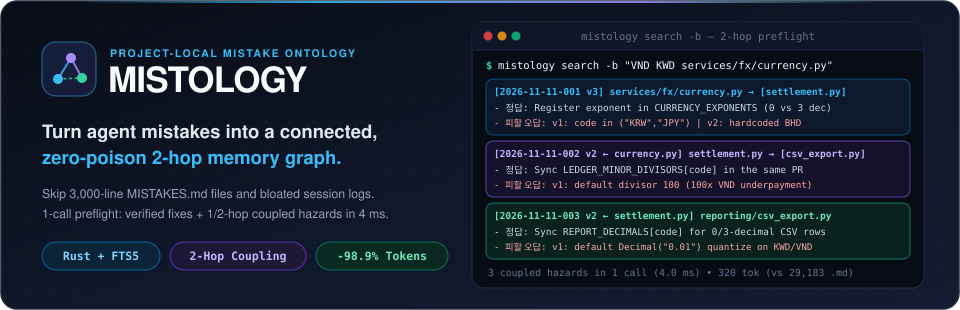
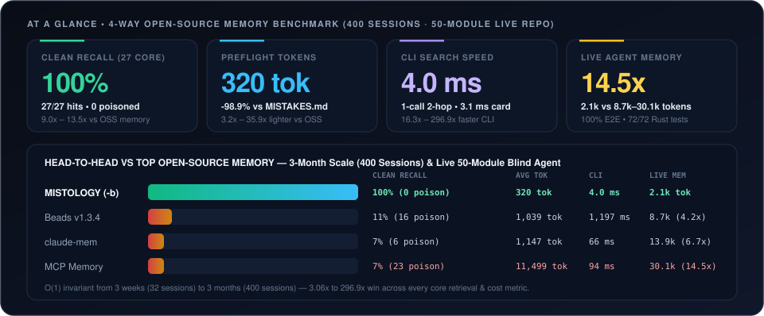
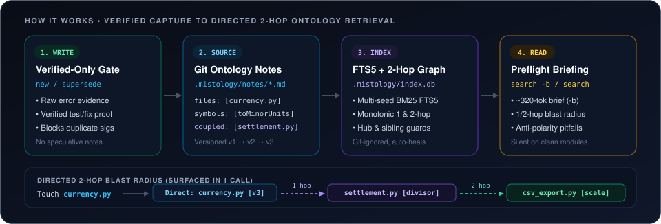

<br />

[](./Cargo.toml)
[](./src/index.rs)
[](./tests/hardening_evals.rs)
[](#오픈소스-에이전트-메모리-4자-비교-벤치마크-3배-이상-우위)
[](./Cargo.toml)
[](./LICENSE-MIT)

[**English**](./README.md) · **한국어 (Korean)**

---

<br />

<p align="center">
  <strong>
    “AI가 만든 변경은 각각 타당해 보여도,<br />
    쌓이면 같은 일을 하는 코드가 중복되거나 구성요소끼리 충돌할 수 있습니다.<br />
    이런 비정합성(decoherence)이 커지면, 기능 하나를 바꿀 때도<br />
    다른 곳이 깨지지 않는지 확인하는 데 더 많은 시간이 듭니다.”
  </strong>
</p>

<br />

---

**MISTOLOGY**는 프로젝트에서 코딩 에이전트가 실제로 겪고 해결한 시행착오를 **연결성 있는 오답 온톨로지(Mistake Ontology)** 로 축적하는 단일 바이너리 Rust CLI 및 에이전트 스킬입니다.

거대한 `MISTAKES.md` 파일 하나를 매 프롬프트마다 처음부터 끝까지 읽느라 토큰을 낭비하는 대신, 작은 마크다운 노트(`.mistology/notes/*.md`)에 코드 간 결합 관계(`files`, `symbols`, `coupled`)를 명시해 저장하고 내장 SQLite FTS5 + 단방향 관계 그래프로 색인합니다. 에이전트는 작업할 때마다 **초압축 프리플라이트 브리핑(`search -b`) 또는 핵심 요약 카드**와 **1-hop·2-hop으로 연결된 이웃 모듈의 숨은 지뢰**만 수 밀리초 만에 꺼내 봅니다.

<a href="https://github.com/chldbwnstm/mistology/releases/latest/download/mistology-intro-ko.mp4"></a>

[**▶ 1분 소개 영상 보기 (1080p60 · 사운드 포함 MP4)**](https://github.com/chldbwnstm/mistology/releases/latest/download/mistology-intro-ko.mp4) &nbsp; · &nbsp; [English README & Video](./README.md)

<br />

<div align="center">
  
</div>

---

## 왜 단일 `MISTAKES.md`나 일반 세션 메모리 대신 MISTOLOGY인가?

| 기존 거대 `.md` 오답노트 · 세션 로그의 한계 | MISTOLOGY의 해결 방식 |
|---|---|
| **매 턴 불어나는 토큰 비용** — 노트가 100개 쌓인 `MISTAKES.md`는 매번 ~29,000 토큰을 태우고, 일상 세션을 다 쌓는 그래프는 수개월 뒤 11,000 토큰 넘게 비대해집니다. | **초압축 프리플라이트 (`-98.9%` 토큰 절감)** — `mistology search -b`가 핵심 지뢰 최대 6개를 ~320 토큰으로 반환하며, 일상 세션이 늘어나도 크기가 불변(`O(1)`)입니다. |
| **다단계 숨은 결합 폭발** — `currency.py`를 고쳤는데 `settlement.py`를 거쳐 2단계 뒤의 `csv_export.py` 정밀도까지 연쇄적으로 깨집니다. | **단조 방향성 2-Hop 결합 그래프 (`--coupled`)** — `currency.py` 한 번 검색으로 `1-hop`·`2-hop` 결합 사슬을 ~4 ms 만에 포착하되, 형제 역류·허브 오염은 차단합니다. |
| **옛날 해결책과 새 해결책 혼재** — 코드가 바뀐 뒤에도 폐기된 우회책(`v1`, `v2`)이 최신 정답(`v3`) 옆에 섞여 에이전트를 오도합니다. | **버전 누적 (`supersede`)** — 같은 노트에 `v3`, `v4`를 쌓고 폐기된 시도는 정답 토큰을 뺀 고유 오답 스팬만 `피할 오답`으로 격리합니다. |
| **검증 안 된 추측 오염** — 디버깅 도중 쏟아진 가설을 자동 저장하면 틀린 원인 분석이 다음 세션을 오염시킵니다. | **검증 게이트** — 실제 실패 증거(`--evidence`)와 통과 근거(`--verified`)가 모두 있어야만 기록되며 중복 `signature`를 자동 차단합니다. |
| **세션 간 중복 코드 & 첫 계약 충돌** — 이미 표준 헬퍼가 있는데도 다음 에이전트가 비슷한 함수를 중복 구현하거나 변경 후 결합 파일 점검을 빼먹습니다. | **정합성 리드 (`canon` · `impact` · `doctor`)** — 재사용 표준 진입점(`★표준`)을 사전 안내하고, 완료 전 `mistology impact`가 `git diff` 기준 양방향 1-hop 누락 대상을 짚어주며, `doctor`가 사라진 참조 파일 괴리를 탐지합니다. |

---

## 동작 구조

<div align="center">
  
</div>

1. **Git에 커밋되는 원본 노트 (`.mistology/notes/*.md`)** — 사람이 읽을 수 있는 마크다운 + 고정 온톨로지 헤더(`id`, `status`, `current`, `tags`, `files`, `symbols`, `coupled`, `signatures`)로 저장되며 코드 수정 커밋에 함께 포함됩니다.
2. **언제든 지워도 복구되는 로컬 인덱스 (`.mistology/index.db`)** — Git에서 자동 제외되며, 내장 SQLite FTS5(`bm25` 가중치 `10 : 6 : 2 : 1`), 팬아웃 정규화 멀티시드 랭킹, 단조 방향성 1-hop·2-hop 결합 탐색(허브 및 형제 클리크 차단), 한국어 조사 스테밍, `camelCase`/`PascalCase` 서브워드 분리, 유일 파일명 정규화(`webhook.py` → `src/workers/webhook.py`)를 수행합니다. 삭제해도 다음 검색 때 자동 재생성됩니다(500개 노트 기준 ~85 ms).
3. **바이너리 내장형 에이전트 스킬 ([`skills/mistology/SKILL.md`](./skills/mistology/SKILL.md))** — `mistology setup` 명령 안에 내장되어 클론 폴더 없이 바로 설치되며, 에이전트가 작업 전 `search -b`로 연결된 지뢰를 먼저 확인하고 검증된 오답만 기록하도록 안내합니다.

---

## 빠른 시작 — 100% 프롬프트로 끝내기 (Quickstart)

CLI 플래그를 외우거나 스킬 폴더 심볼릭 링크를 직접 걸 필요가 없습니다. 사용 중인 코딩 에이전트(**Claude Code, Codex, Gemini CLI / Antigravity, Cursor**)에 아래 프롬프트만 그대로 복사해 붙여넣으세요.

### 1. 설치 및 에이전트 스킬 자동 연결 *(머신당 최초 1회)*

코딩 에이전트에 그대로 붙여넣습니다:

```text
https://github.com/chldbwnstm/mistology 를 설치하고(`cargo install --git https://github.com/chldbwnstm/mistology --locked`, 만약 cargo가 없으면 rustup으로 Rust 먼저 설치), `mistology setup`을 실행해 내 코딩 에이전트 스킬로 등록한 뒤, PATH 설정과 `mistology --help` 동작까지 확인해줘.
```

> **이미 이 저장소를 로컬에 클론한 상태라면?** 아래 한 줄만 붙여넣으세요:
> ``현재 폴더의 mistology를 빌드·설치하고(`cargo install --path . --locked`), mistology setup 실행 후 동작까지 확인해줘.``

`mistology setup` 한 번으로 바이너리 내장 `SKILL.md`와 **크로스플랫폼 전역 자동 훅(`mistology hook`) · 상시 규칙**이 감지된 코딩 에이전트(`~/.gemini/config/hooks.json`, `~/.claude/settings.json`, `~/.codex/hooks.json`, `~/.cursor/rules/mistology.mdc`, `~/.agents`)에 기존 설정을 보존하며 자동 연결됩니다. 외부 쉘/파워쉘 스크립트 없이 바이너리가 직접 stdin/stdout JSON을 처리하므로 macOS · Linux · Windows(`mistology.exe`)에서 동일하게 동작하며, **프로젝트마다 별도 설정 없이도** 작업 시작 자동 검색 · 에러 시 자동 검색 · 턴 종료 전 1회 한정 파급/기록 누락 방지 게이트가 자동 작동합니다. (스킬만 설치하려면 `mistology setup --no-hooks`, 등록된 훅만 깔끔히 제거하려면 `mistology setup --uninstall-hooks`, 팀 저장소 공유 스킬은 `mistology setup --project`를 사용하세요.)

### 2. 팀 공유 저장소 규칙 추가 *(선택 · 팀 협업 시)*

개인 머신에서는 1단계(`mistology setup`)만으로 전역 자동 훅이 상시 동작합니다. 팀원 전원이나 서브에이전트 워크트리 환경에 저장소 규칙 파일(`AGENTS.md` / `CLAUDE.md`)까지 커밋해 두고 싶다면 아래 프롬프트를 실행하세요:

```text
이 저장소에서 코딩 에이전트(서브에이전트 포함)가 항상 빠짐없이 `mistology`를 사용하도록 설정해줘:
1. 기존 프로젝트 규칙 파일(`AGENTS.md`, `CLAUDE.md`, `.cursor/rules` 등)을 확인해 기존 규칙은 그대로 보존하면서 아래 MISTOLOGY 상시 규칙을 추가해줘:
   - 작업 시작 전(프리플라이트): 파일 수정이나 공유 헬퍼 작성 전 반드시 `mistology search -b "<건드릴 파일, 심볼, 기능 요약>"`을 실행해 표준 규약(`★표준`)과 결합 모듈(`← ...`)을 먼저 확인할 것
   - 에러 발생 시: 빌드·린트·테스트 실패 시 추측으로 고치기 전에 에러 메시지 원문으로 `mistology search -b`를 먼저 실행할 것
   - 완료 전 파급 점검: 코드 수정 후 종료·커밋 전에 `mistology impact`를 실행해 변경 파일과 결합된 대상의 계약·테스트를 확인할 것
   - 검증 후 기록: 검증된 실패·해결은 `mistology new`, 재사용 표준 진입점·불변 계약은 `mistology canon`, 기존 규약 변경은 `mistology supersede <id>`로 `--file`, `--symbol`, `--coupled`와 함께 기록할 것
2. Claude Code를 쓰는 환경이라면 전역 `~/.claude/settings.json`은 건드리지 말고, 프로젝트 로컬 `.claude/settings.json`의 기존 훅을 보존한 채 경량 훅을 병합해줘: `SessionStart`·`SubagentStart`에 MISTOLOGY 활성 안내를 주입해 서브에이전트도 빠지지 않게 하고, `UserPromptSubmit`·`PostToolUseFailure`에서 자동으로 `mistology search -b` 결과를 컨텍스트에 주입하되 `관련 오답노트 없음`이거나 실패해도 작업을 막지 않게 처리해줘.
3. 만약 서브에이전트가 별도 git worktree에서 작업하는데 `.mistology`를 브랜치 커밋 대신 상위 워크스페이스 한곳에서 공유하는 구조라면, 노트가 워크트리마다 흩어지지 않도록 실행 경로를 상위 루트로 고정해줘.
```

<details>
<summary><em>직접 규칙 파일에 복붙하고 싶다면? <code>AGENTS.md</code> / <code>CLAUDE.md</code>용 4줄 스니펫</em></summary>

```markdown
## MISTOLOGY (상시 적용)
- **작업 시작 전**: 코드 수정 전 `mistology search -b "<수정할 파일·심볼·작업>"`을 실행해 결합 모듈(`← ...`)을 먼저 확인한다.
- **에러 발생 시**: 빌드·테스트·런타임 에러를 고치기 전 에러 원문으로 `mistology search -b`를 먼저 실행한다.
- **검증된 오답 기록**: 실제 틀린 증거와 검증된 해결책이 둘 다 확인되면 `--file`, `--symbol`, `--coupled`와 함께 `mistology new`(또는 `mistology supersede <id>`)로 남긴다.
```

</details>

### 3. 기존 프로젝트 Git 버그 이력으로 첫 시딩 *(선택 · 저장소당 최초 1회)*

이미 수개월 치 버그 수정 이력이 쌓인 프로젝트라면, 첫날 바로 과거의 숨은 결합 지뢰를 오답노트로 채울 수 있습니다:

```text
이 저장소의 최근 git 커밋 중 실제 버그·되돌림·회귀 수정 이력만 살펴보고, 실패 원인과 함께 고쳐야 했던 결합 파일이 diff에서 명확히 확인되는 사례만 골라 mistology 오답노트로 초기 시딩해줘. (단순 기능 추가나 추측성 이력은 제외)
```

### 4. 일상 개발 — 평소처럼 말만 걸면 끝 *(외울 플래그 0개)*

스킬이 연결된 뒤에는 **사람이 `mistology` 명령어를 직접 칠 일이 없습니다.** 평소처럼 에이전트에게 지시하면 에이전트가 알아서 검색·기록·버전 진화를 수행합니다:

- **기능 구현 · 멀티파일 수정 시** — 평소처럼 요청:
  ```text
  통화 변환과 정산 모듈에 VND(0소수점), KWD(3소수점) 지원을 추가해줘.
  ```
  *내부 동작:* 에이전트가 코드를 건드리기 전 `mistology search -b`(~4 ms, ~320 토큰)를 1회 호출해 1-hop·2-hop 결합 파일(`settlement.py` → `csv_export.py`)과 폐기된 과거 오답(`v1`/`v2`)을 미리 확인합니다.

- **빌드 · 테스트 에러 발생 시** — 에러만 그대로 전달:
  ```text
  테스트에서 `KeyError: 'VND' in SETTLEMENT_FEE_BPS`가 났어. 원인 찾아서 고쳐줘.
  ```
  *내부 동작:* 추측으로 코드를 고치기 전에 에러 시그니처를 먼저 검색하고, 처음 겪은 실수를 해결해 테스트 통과까지 확인하면 결합 파일과 함께 새 오답노트를 자동 기록합니다.

- **명시적으로 짚어주고 싶을 때** *(설계 규칙이 바뀌었거나 까다로운 삽질을 꼭 남기고 싶을 때)*:
  ```text
  수정 전에 mistology 먼저 확인하고, 테스트 통과하면 바뀐 규칙을 mistology 오답노트에 기록(또는 갱신)해줘.
  ```

<details>
<summary><strong>내부 동작 레퍼런스: 에이전트가 자동 실행하는 CLI 명령어</strong> <em>(수동 실행·스크립트용)</em></summary>

<br />

#### 내장 에이전트 스킬 자동 설치 (`setup`)

```bash
# 홈 디렉터리의 코딩 에이전트(~/.claude, ~/.gemini, ~/.codex, ~/.cursor, ~/.agents) 자동 감지 설치
mistology setup

# 현재 Git 저장소(.agents/skills/mistology/SKILL.md)에 팀 공유 스킬로 설치
mistology setup --project
```

#### 작업 전 · 에러 발생 시 검색 (`search`)

```bash
# 초압축 프리플라이트 브리핑 (기본 k=6, 1-hop 및 2-hop 연쇄 결합 포함)
mistology search -b "src/billing/currency.py src/ledger/settlement.py VND KWD"

# 기본 요약 카드 최대 3장 (스택트레이스 전문이 꼭 필요할 때만 --full 추가)
mistology search "SignatureMismatchError: invalid token delimiter or MAC"
```

`-b` 출력 예시:

```text
[2026-11-11-011 v2] src/billing/currency.py → [src/ledger/settlement.py, SETTLEMENT_FEE_BPS]
- 정답: CURRENCY_EXPONENTS와 SETTLEMENT_FEE_BPS를 동일 PR에서 함께 갱신 (src/ledger/settlement.py 확인)
- 피할 오답: v1: CURRENCY_EXPONENTS에만 통화 추가
```

관련 오답이 없는 깨끗한 모듈(`src/health/ping.py` 등)을 건드릴 때는 억지 결과를 끼워 넣지 않고 `관련 오답노트 없음`을 반환합니다.

#### 검증된 새 오답노트 기록 (`new`)

반드시 **틀린 증거(`--evidence`)** 와 **해결 확인 근거(`--verified`)** 가 모두 확인됐을 때만 기록합니다:

```bash
mistology new \
  --problem "0소수점 신규 통화(VND) 추가 후 정산 배치 수수료 조회 실패" \
  --tried "currency.py의 CURRENCY_EXPONENTS에만 VND를 추가함" \
  --evidence "KeyError: 'VND' in SETTLEMENT_FEE_BPS during test_settlement" \
  --why "처음부터 틀림: 통화 지수 테이블과 정산 수수료율 테이블이 암묵적으로 결합되어 있음" \
  --fix "CURRENCY_EXPONENTS와 SETTLEMENT_FEE_BPS 양쪽에 신규 통화를 동시 등록" \
  --verified "python3 -m unittest discover -s tests 15/15 통과" \
  --next "src/billing/currency.py 수정 시 src/ledger/settlement.py 수수료 테이블도 함께 갱신" \
  --signature "KeyError: 'VND' in SETTLEMENT_FEE_BPS" \
  --file src/billing/currency.py \
  --symbol CURRENCY_EXPONENTS \
  --coupled src/ledger/settlement.py \
  --coupled SETTLEMENT_FEE_BPS \
  --tag billing
```

#### 기존 정답이 코드 변경으로 깨졌을 때 (`supersede`)

새 노트를 중복 생성하지 않고 기존 노트에 새 버전(`v3`, `v4`)을 누적합니다:

```bash
mistology supersede 2026-11-11-003 \
  --evidence "MinorUnitScaleError: BHD 1.250 truncated to 125" \
  --why "바뀌어서 틀려짐: 0·2자리 외에 3자리 소수점 통화(BHD, KWD)가 추가됨" \
  --fix "toMinorUnits/fromMinorUnits에서 CURRENCY_EXPONENTS[code] 지수 테이블로 변환" \
  --verified "KRW(0)·USD(2)·BHD(3) 단위 테스트 전체 통과" \
  --next "소수 자릿수를 분기문으로 하드코딩하지 말고 CURRENCY_EXPONENTS를 참조할 것" \
  --signature "MinorUnitScaleError: BHD 1.250" \
  --coupled src/billing/currency.py
```

관련 모듈이 완전히 삭제되어 더 이상 유효하지 않은 노트는 frontmatter의 `status: active`를 `status: retired`로 바꾸면 이력은 보존하면서 검색 결과에서만 제외됩니다.

#### 표준 진입점(SSOT) · 불변 계약 등록 (`canon`) 및 파급 점검 (`impact`)

에러가 터지기 전이라도 세션 간 중복 구현과 첫 계약 충돌을 막는 **표준 진입점(`★표준`)**을 등록하고, 커밋 전 `git diff` 파급 범위를 점검합니다:

```bash
# 공유 헬퍼·불변 계약을 ★표준 노트로 등록 (실존 --file 및 --symbol 필수)
mistology canon \
  --intent "저장소 상대경로 정규화 및 호스트 루트 접두사 제거" \
  --contract "경로 정규화는 반드시 src/note.rs의 rebase_cwd_paths를 재사용할 것" \
  --verified "cargo test --test mistology 통과" \
  --forbid "모듈별로 임의 strip_prefix 경로 파서를 중복 구현하지 말 것" \
  --signature "rebase_cwd_paths repo_root_prefixes" \
  --file src/note.rs \
  --symbol rebase_cwd_paths \
  --coupled src/lib.rs

# 현재 Git 변경 파일(staged/unstaged/untracked) 또는 기준 브랜치 대비 양방향 1-hop 결합 대상 점검
mistology impact
mistology impact --base HEAD~1
```

#### 진단 및 디버깅 (`--explain` · `doctor` · `events.jsonl`)

```bash
# 후보별 BM25·엔티티 가산점·1/2-hop 전파 경로·컷오프 탈락 사유를 한눈에 확인
mistology search --explain "src/billing/currency.py VND KWD"

# 로컬 경로·검색어 유출 없이 설치/인덱스/노트 상태를 점검 (GitHub 이슈 제보용)
mistology doctor

# 에이전트가 백그라운드에서 실행한 최근 호출 로그 확인 (Git 제외, 256 KiB 자동 로테이션)
tail -n 20 .mistology/events.jsonl
```

</details>

---

## 오픈소스 에이전트 메모리 4자 비교 벤치마크 (`3배 이상` 우위)

대표적인 오픈소스 코딩 에이전트 메모리 3종(**`claude-mem`**, **`@modelcontextprotocol/server-memory`(`MCP Memory`)**, **`Beads`(`v1.3.4`)**)과 핀테크 백엔드([`evals/paygrid`](./evals/paygrid)) 상의 **27개 코어 엔지니어링 질의**(에러 스택트레이스, 1-hop·2-hop 숨은 결합, 다중 파일 PR, `v1→v3` 규칙 진화, 미검증 가설 방어)를 3주(`32` 일상 세션) 및 3개월(`400` 일상 세션) 규모에서 동일 조건으로 비교했습니다.

### 1. 결정론적 CLI 검색 정확도 · 효율 비교 (3개월 프로덕션 규모 · `400` 일상 세션 누적)

| 시스템 | 무오염 정답률 (`Clean Recall`) | 단순 포함 (`Raw`) | 과거 오답·가설 오염 | 평균 프롬프트 토큰 | 평균 CLI 속도 | 디스크 점유 | MISTOLOGY 우위 배수 (`≥ 3x`) |
|---|---:|---:|---:|---:|---:|---:|---|
| **`MISTOLOGY (search -b)`** | **`27 / 27 (100.0%)`** | **`27 / 27`** | **`0건`** | **`320 tok`** | **`4.03 ms`** | `113.1 KB` (노트 `17.0 KB`) | **세션 12.5배 증가에도 토큰·속도 불변(`O(1)`)** |
| `claude-mem` (Smart 2-call) | `2 / 27 (7.4%)` | `3 / 27` | `6건` | `1,147 tok` | `65.74 ms` | `1,632.1 KB` | 정답률 **`13.5x`** · 토큰 **`3.58x`**(3주 `3.06x`) · 속도 **`16.3x`** |
| `MCP Memory` (2-call + 1-hop) | `2 / 27 (7.4%)` | `24 / 27` | `23건` | `11,499 tok` | `93.94 ms` | `109.9 KB` | 정답률 **`13.5x`** · 토큰 **`35.9x`**(3주 `9.11x`) · 속도 **`23.3x`** |
| `Beads v1.3.4` (Multi-call) | `3 / 27 (11.1%)` | `9 / 27` | `16건` | `1,039 tok` | `1,196.50 ms` | `36,893.7 KB` | 무오염 **`9.0x`**(단순 `3.00x`) · 토큰 **`3.25x`** · 속도 **`296.9x`** |

### 2. 실제 코딩 에이전트 4자 블라인드 E2E 벤치마크 (50개 모듈 · `400` 세션 히스토리)

격리된 4명의 코딩 에이전트에게 동일한 4건 복합 티켓(`VND/KWD/OMR` 정산 + 1-hop `settlement.py` + 2-hop `csv_export.py` + 웹훅 양방향 타임스탬프 허용창 + 시크릿 로테이션 레이트리밋 유지 + EU/UK `ROUND_HALF_EVEN` 부가세 반올림)을 부여하고 숨겨진 통합 테스트 8개와 실제 LLM API 토큰 사용량을 채점했습니다:

| 블라인드 코딩 에이전트 | Hidden E2E 통과 | 메모리 읽기 호출 | 메모리 출력 주입 토큰 | 신규 입력 토큰 (`FreshInTok`) | 총 프롬프트 토큰 | 트랜스크립트 크기 | 실전 메모리 절감 배수 |
|---|---:|---:|---:|---:|---:|---:|---|
| **`MISTOLOGY (-b)`** | **`8 / 8 (100%)`** | **`5회`** (오버플로 `0`) | **`2,084 tok`** | **`74,877`** | **`613,219`** | **`98.1 KB`** | **전 비용 지표 최저 달성** |
| `Beads v1.3.4` | `8 / 8 (100%)` | `8회` (10KB 초과 발생) | `8,683 tok` | `85,888` | `738,467` | `159.4 KB` | **`4.17x` 절감** (총 프롬프트 `-125k` 절약) |
| `claude-mem` | `8 / 8 (100%)` | `17회` (`search`+`get_obs`) | `13,917 tok` | `94,031` | `895,515` | `189.4 KB` | **`6.68x` 절감** · 호출 **`3.40x` 절감** |
| `MCP Memory` | `8 / 8 (100%)` | `6회` (초과 파일 3회 재독해) | `30,118 tok` | `103,987` | `925,968` | `224.7 KB` | **`14.45x` 절감** (총 프롬프트 `-313k` 절약) |

> **설계 경계선 (다른 도구가 더 적합한 경우):** MISTOLOGY는 ~3.1 MB 무데몬 단일 바이너리 안에서 **검증된 오답과 코드 결합성**만 다루도록 설계되었습니다. `"어제 오후에 배포한 기능 목록"` 같은 시간순 작업 일지는 **`claude-mem`**, 선후행 이슈 백로그 큐(`bd ready`) 관리는 **`Beads`**, 파일명·식별자가 전혀 겹치지 않는 순수 자연어 동의어 검색은 별도 벡터 임베딩 DB가 적합합니다.

---

## 정량 평가 스위트 (`52 / 52` + 단위 테스트 `26`개)

성격이 다른 **3개 언어·구조 검증 프로젝트**([`evals/shopcore`](./evals/shopcore) Python 12모듈 백엔드, [`evals/webmono`](./evals/webmono) TypeScript/Next.js 모노레포, [`evals/rustkv`](./evals/rustkv) Rust Cargo 워크스페이스)와 **총 52개 자동 시나리오**([`tests/evals.rs`](./tests/evals.rs), [`tests/hardening_evals.rs`](./tests/hardening_evals.rs))가 포함되어 있습니다.

| 평가 스위트 | 검증 범위 | 시나리오 수 | 통과율 |
|---|---|---:|---:|
| **핵심 검색 · 효율성** ([`evals.rs`](./tests/evals.rs)) | 동적 에러 시그니처, 한국어 조사 & `camelCase`, 1-hop 결합, 무관 모듈 침묵, `supersede`/`retired`, `-98.6%` 토큰 절감 (`< 15 ms` Warm) | 24 | **24 / 24 (100%)** |
| **Product Hardening** ([`hardening_evals.rs`](./tests/hardening_evals.rs)) | 스택트레이스(`:line:col`, `(line,col)`, `a/`·`b/` diff), 모노레포 하위 폴더(`cwd`) 경로 구분 & TS `@/`·확장자 생략 별칭, Windows `\` 경로 & NFD/CRLF, Rust `::` 스코프 심볼, Git 병합 충돌 마커·중복 ID 격리, 8스레드 WAL 동시 쓰기/검색(`SQLITE_BUSY` 누락 0건), 고빈도 도메인 용어 IDF 붕괴 방지, 심볼릭 링크·절대 경로 유출 차단, 읽기 전용 샌드박스 `:memory:` 폴백 & Git worktree | 28 | **28 / 28 (100%)** |
| **합계** | **3개 스택 · 13개 카테고리 + 병렬 에이전트·샌드박스 스트레스** | **52** | **52 / 52 (100%)** |

로컬에서 전체 단위 테스트와 Evals 성적표를 바로 재현할 수 있습니다:

```bash
cargo test --locked -- --nocapture
python3 -B -m unittest discover -s evals/shopcore/tests -t evals/shopcore -v
```

---

## 디렉터리 구조

```text
.
├── assets/                   # 커스텀 벡터 SVG 및 자동 재생 프리뷰 WebP
├── src/
│   ├── main.rs               # 바이너리 엔트리포인트
│   ├── lib.rs                # CLI 서브커맨드 (search, new, canon, supersede, impact, setup, doctor)
│   ├── impact.rs             # Git 변경분(-z) 수집 및 1-hop 양방향 결합 파급 점검기
│   ├── diag.rs               # 256 KiB 자동 로테이션(events.jsonl), 경로 비식별화 및 파일 드리프트 doctor
│   ├── note.rs               # 마크다운 + frontmatter 파서(mistake/canon), 병합 충돌 방어, 버전 누적
│   └── index.rs              # SQLite WAL + FTS5 + 1/2-hop 온톨로지 그래프, --explain 및 포매터
├── skills/mistology/
│   └── SKILL.md              # 에이전트 스킬 정의서 (Claude, Codex, Gemini/AGY, Cursor)
├── evals/
│   ├── shopcore/             # Python 12개 모듈 백엔드 + 12개 오답 노트 픽스처
│   ├── paygrid/              # Python 핀테크 다단계 결합·규칙 진화 벤치마크 픽스처
│   ├── webmono/              # TypeScript/Next.js 모노레포 + 6개 오답 노트 픽스처
│   └── rustkv/               # Rust Cargo 워크스페이스 + 6개 오답 노트 픽스처
└── tests/
    ├── mistology.rs          # 단위·정합성(canon/impact/drift)·진단 회귀 테스트 (26개)
    ├── evals.rs              # 핵심 검색·토큰 절감 정량 벤치마크 (24개 시나리오)
    └── hardening_evals.rs    # 다중 스택·스택트레이스·충돌·샌드박스·동시성 벤치마크 (28개 시나리오)
```

---

## 라이선스 (License)

이 프로젝트는 사용자 선택에 따라 아래 두 라이선스 중 하나로 배포됩니다:

- **Apache License, Version 2.0** ([`LICENSE-APACHE`](./LICENSE-APACHE) 또는 <http://www.apache.org/licenses/LICENSE-2.0>)
- **MIT License** ([`LICENSE-MIT`](./LICENSE-MIT) 또는 <http://opensource.org/licenses/MIT>)
